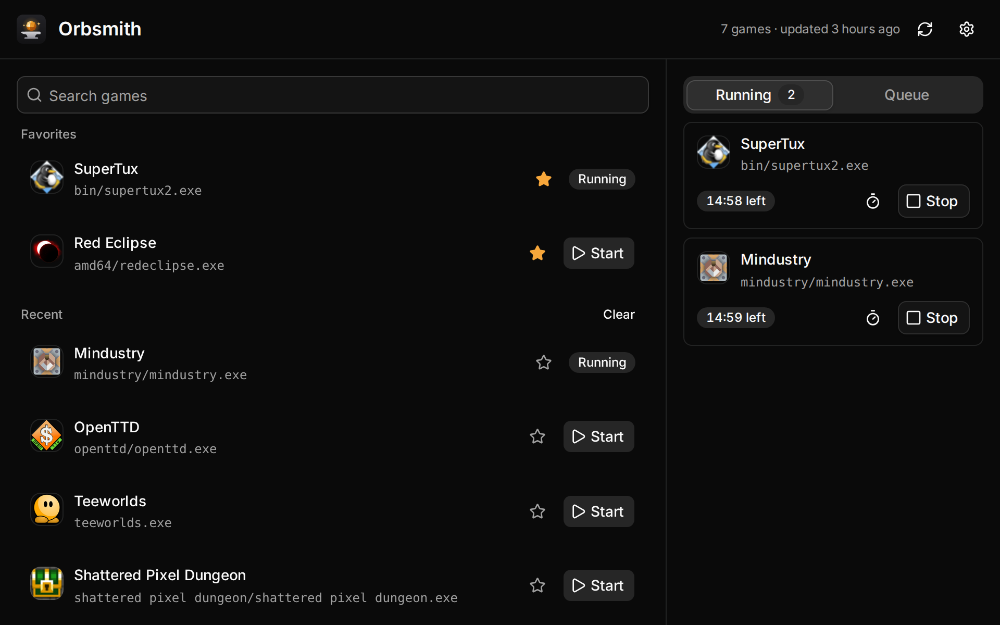
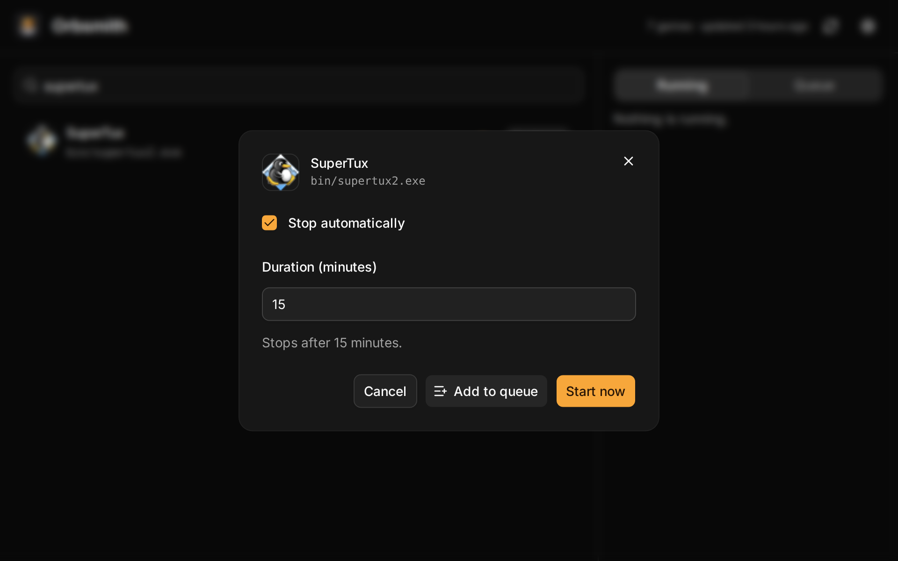
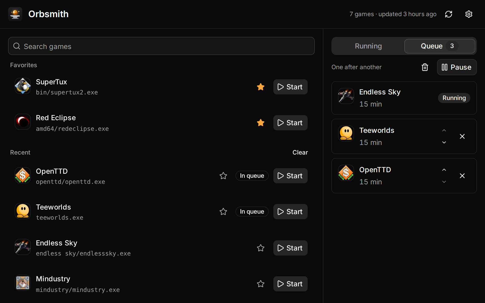

<p align="center">
  
</p>

<h1 align="center">Orbsmith</h1>

Desktop app that launches stand-in processes named after game executables, so that software detecting running games sees them as launched.

> [!IMPORTANT]
> Orbsmith is not affiliated with any software or game publisher.

> [!WARNING]
> Using Orbsmith may go against the terms of service of the software that detects running games. Use it at your own risk.



<sub>Orbsmith is not affiliated with any of the games shown.</sub>

## Installation

Orbsmith currently runs on Windows 10 and 11 (x64). Linux support is planned.

1. Download the latest installer from the [Releases](https://github.com/alexwauquier/orbsmith/releases) page:
   - `Orbsmith_<version>_x64-setup.exe` (recommended), or
   - `Orbsmith_<version>_x64_en-US.msi`, for deployment with Windows Installer.
2. Run it. The installers are not code-signed, so Windows SmartScreen warns about an unrecognized app: click **More info**, then **Run anyway**.

The setup installs Microsoft Edge WebView2 if it is missing. It is preinstalled on Windows 11 and on up-to-date Windows 10.

To update, run the installer of the new version. It detects the installed one and replaces it, keeping your data.

## Usage

1. Search for a game by name. Star the ones you use often: favorites and recently started games show up before you search. **Clear** empties the recent games.
2. Click **Start**, enter how long the game should run (for example, a quest duration), then **Start now**: the game stops automatically once that time has elapsed. Untick **Stop automatically** to keep it running until you stop it. If a game lists several executables and isn't detected, pick another one in **Executable**. Orbsmith remembers the duration and executable you last used for each game.
3. The **Running** panel lists the active games with their remaining time. You can change the timer or stop a game at any time.



### Queue

To run several games in a row, choose **Add to queue** instead of **Start now**: the game joins the **Queue** tab with its duration. Reorder it with the arrows, or empty it with the bin button. **Start queue** runs them one after another, each for its duration, and works through the list on its own, even when the window is hidden in the tray. **Pause** stops the current game and keeps its remaining time: **Resume** restarts it for just that long, then carries on with the queue. **Stop all** in the tray menu pauses the queue the same way. Stopping a queued game from the **Running** tab skips to the next one. The queue is saved: after closing Orbsmith, it comes back paused, ready to resume.



To run every game in the queue at the same time instead, turn on **Run the queue in parallel** in the settings (gear icon in the header).

Simulated games run in the background: they don't appear in the taskbar. A notification tells you when one stops on its own.

Closing the window while games are running keeps Orbsmith in the system tray, so they keep running. Click the tray icon to reopen it; its menu also stops every game or quits. With nothing running, closing the window quits Orbsmith. If Orbsmith crashes, its stand-in processes exit on their own, and any leftover is cleaned up at the next start.

The list of games is downloaded once and cached; use the refresh button in the header to update it. Orbsmith only downloads that public list and the game icons: no account, no login.

## Data and uninstalling

Orbsmith keeps its data in `%APPDATA%\Orbsmith`: the cached list of games, your settings, the queue, the stand-in executables, and the WebView data, which includes your favorites, recent games and how you last started each one.

- The `setup.exe` uninstaller deletes that folder if you tick **Delete the application data**.
- The MSI uninstaller leaves it in place, as Windows Installer does for user data. Delete the folder by hand to remove it.

## Tech stack

- [Tauri 2](https://tauri.app) (Rust backend, system WebView)
- [Svelte 5](https://svelte.dev) and [Vite](https://vite.dev)
- [Tailwind CSS 4](https://tailwindcss.com) and [shadcn-svelte](https://shadcn-svelte.com)
- [Oxlint](https://oxc.rs/docs/guide/usage/linter) and [Oxfmt](https://oxc.rs/docs/guide/usage/formatter)

## Development

### Prerequisites

- Node.js 24+ and pnpm
- Rust stable (1.90+)
- [Tauri system prerequisites](https://tauri.app/start/prerequisites/) for your platform

### Project layout

- `src/`: the Svelte frontend
- `src-tauri/`: the Tauri app, which exposes the commands to the frontend
- `crates/core/`: the game list, executable path validation and process management
- `crates/dummy/`: the stand-in process launched under each game's executable name

### Commands

```sh
pnpm install       # install dependencies
pnpm tauri dev     # run the app in development mode
pnpm tauri build   # build the installers
pnpm check         # type-check
pnpm lint          # lint the code
pnpm format        # format the code
pnpm format:check  # check formatting
pnpm test          # run the frontend tests
cargo fmt --all    # format the Rust code
cargo clippy --workspace --all-targets
cargo test --workspace
```

On Linux, the Tauri app needs the [system prerequisites](https://tauri.app/start/prerequisites/) to build; `cargo test -p orbsmith-core` works without them.

### Releases

Pushing a `v*` tag builds the Windows installers and attaches them to a draft GitHub release. The tag must match the version in `package.json`, `Cargo.toml` and `src-tauri/tauri.conf.json`.

## License

Released under the [MIT License](LICENSE).
